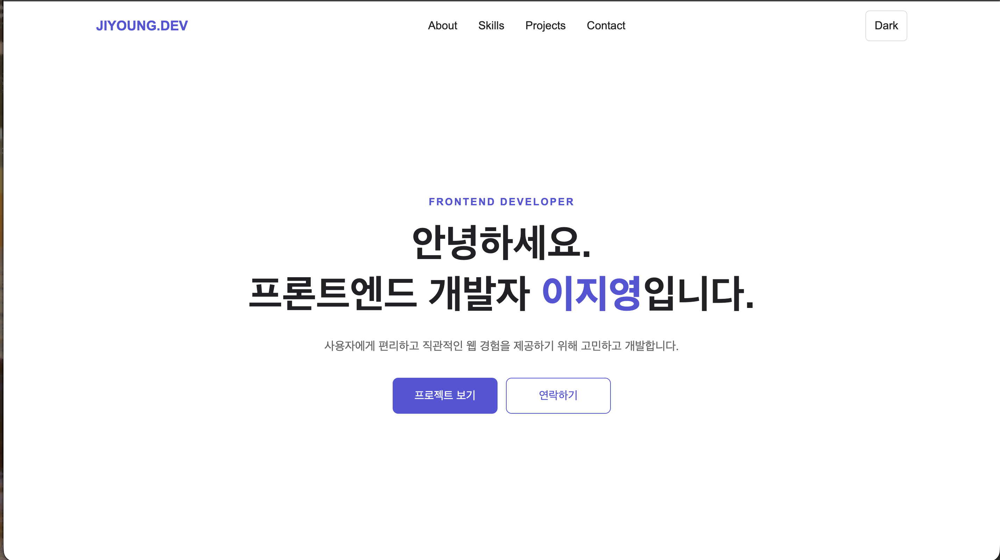
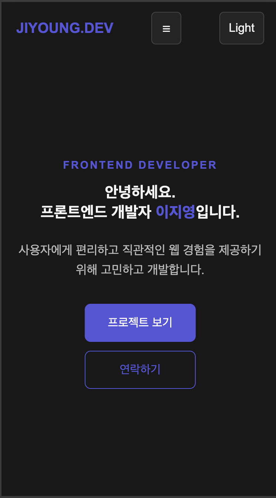

<!-- @format -->

# About Me

순수 HTML, CSS, JavaScript로 만든 이지영의 반응형 포트폴리오입니다. 사용자 이벤트를 받아 상태를 변경하고 DOM을 업데이트하는 흐름과 비동기 API 처리를 직접 구현했습니다. 외부 프레임워크나 UI 라이브러리는 사용하지 않았습니다.

- [배포 사이트 — GitHub Pages](https://l-jy16.github.io/aboutme/)

## 1. 개발 목적과 학습 범위

이번 과제는 프레임워크를 사용하기 전에 웹페이지가 동작하는 기본 원리를 이해하는 것이 목적입니다. 화면을 꾸미는 것뿐 아니라 사용자의 클릭·스크롤·입력에 따라 데이터를 확인하고 DOM을 변경하는 과정을 직접 작성했습니다.

```text
사용자 이벤트
  → JavaScript 이벤트 핸들러 실행
  → 상태 확인 또는 변경
  → DOM의 속성·클래스·내용 변경
  → 브라우저 화면 갱신
```

HTML은 콘텐츠의 구조, CSS는 배치와 표현, JavaScript는 동작을 담당합니다. 세 역할을 파일로 나누어 화면 구조를 바꾸는 작업과 기능을 수정하는 작업을 구분했습니다.

## 2. 개발 환경과 실행 조건

| 구분             | 내용                                      |
| ---------------- | ----------------------------------------- |
| 언어             | HTML5, CSS3, JavaScript ES6+              |
| 개발 도구        | VS Code, Live Server                      |
| 실행 환경        | 최신 Chrome을 기준으로 확인할 웹 브라우저 |
| 외부 통신        | GitHub REST API                           |
| 브라우저 저장    | localStorage의 theme 키                   |
| 배포             | GitHub Pages                              |
| 외부 라이브러리  | 사용하지 않음                             |
| 패키지 설치·빌드 | 별도 과정 없음                            |

프로젝트는 정적 웹사이트이므로 별도 서버 프로그램이나 데이터베이스가 필요하지 않습니다. GitHub 저장소 조회는 외부 API 통신이므로 인터넷 연결이 필요합니다. Contact는 입력 검증까지 구현했으며 입력 내용을 서버나 이메일로 보내지 않습니다.

## 3. 파일별 책임과 실행 순서

| 파일·폴더     | 책임                | 주요 내용                                               |
| ------------- | ------------------- | ------------------------------------------------------- |
| index.html    | 문서 구조와 콘텐츠  | 시맨틱 영역, 앵커 링크, 프로필, 문의 폼, 상태 표시 영역 |
| css/style.css | 화면 표현           | CSS 변수, 테마, Flex/Grid, 반응형, hover·transition     |
| js/main.js    | 이벤트와 화면 갱신  | 메뉴·테마·스크롤, API 요청·카드 생성, 폼 검증           |
| images/       | 정적 이미지         | 프로필과 README 화면 캡처                               |
| README.md     | 설계·실행·평가 안내 | 구현 이유, 동작 흐름, 확인 방법과 한계                  |

페이지가 열리면 HTML 파싱 후 defer 스크립트가 실행됩니다. DOM 요소 선택 → localStorage 복원 및 STATE 초기화 → 이벤트·Observer 등록 → renderMenu/renderTheme/renderScroll/renderForm 초기 호출 → loadProjects 요청 순서로 진행합니다. API를 기다리는 동안 브라우저의 다른 작업과 사용자 상호작용은 계속할 수 있습니다.

## 4. 핵심 코드와 구현 이유

### DOM 선택과 이벤트 등록

DOM은 HTML을 JavaScript에서 접근할 수 있는 객체와 트리로 표현한 것입니다. `querySelector`는 선택자와 일치하는 첫 요소를, `querySelectorAll`은 여러 요소를 선택합니다. 선택한 요소에 `addEventListener`를 연결하여 click, input, submit, scroll 이벤트를 처리합니다.

```javascript
menuButton.addEventListener("click", () => {
  STATE.menuOpen = !STATE.menuOpen;
  renderMenu();
});
```

버튼 클릭은 이벤트이고, 불리언 반전은 상태 변경이며, `renderMenu()`는 화면 갱신입니다. render 함수에서는 `classList.toggle('active', STATE.menuOpen)`으로 상태에 맞게 클래스를 적용합니다. 두 번째 인자를 생략하면 클래스 유무를 반전하지만, 여기서는 STATE의 값에 따라 추가·제거하므로 렌더 함수를 반복 호출해도 상태와 화면이 어긋나지 않습니다.

### onclick과 addEventListener의 차이

| 방식                 | 특징                                                      |
| -------------------- | --------------------------------------------------------- |
| HTML onclick 속성    | HTML에 JavaScript를 작성하여 구조와 동작이 섞임           |
| element.onclick 대입 | 동일 속성에 다시 대입하면 이전 핸들러 교체                |
| addEventListener     | 서로 다른 리스너를 추가 등록하고 once 등의 옵션 지정 가능 |

이번 프로젝트는 HTML과 동작의 역할을 분리하기 위해 addEventListener를 사용합니다. 이름 있는 함수 참조를 보관하면 removeEventListener로 제거할 수도 있습니다. 동일 함수와 옵션을 중복 등록하는 경우 무조건 리스너가 늘어나는 것은 아닙니다.

### API·HTTP·비동기 처리

API는 다른 프로그램의 데이터나 기능을 정해진 방식으로 사용하는 인터페이스이고, HTTP는 요청과 응답을 주고받는 통신 규칙입니다. 이 프로젝트는 HTTPS로 GitHub API에 요청하여 프로젝트 정보를 가져옵니다.

```javascript
const response = await fetch(
  `https://api.github.com/users/${GITHUB_USERNAME}/repos`
);
if (!response.ok) throw new Error(`GitHub API Error: ${response.status}`);
const repositories = await response.json();
```

fetch는 요청을 시작하고 Promise를 반환합니다. await는 현재 async 함수의 다음 처리를 응답 이후로 이어주며 브라우저 전체를 멈추지 않습니다. response는 응답 객체이며, 실제 저장소 배열은 json 변환 이후 얻습니다. response.ok는 HTTP 상태가 200~299일 때 true입니다. HTTP 오류는 fetch 자체가 reject되지 않을 수 있으므로 직접 검사하고 throw하여 catch에서 처리합니다. 네트워크·JSON 해석 실패도 catch로 이동합니다.

### filter·map·forEach 적용

```javascript
const visibleRepositories = repositories.filter(
  (repository) => language === "all" || getLanguage(repository) === language
);
```

filter는 원본을 변경하지 않고 선택한 언어에 맞는 저장소의 새 배열을 만듭니다. 전체를 선택하면 모든 항목이 통과합니다. 언어가 null이면 '언어 미지정'으로 분류합니다. 필터 결과는 map으로 카드 HTML 문자열 배열로 변환하고 join으로 합칩니다. API 문자열은 escapeHTML로 이스케이프하여 텍스트가 HTML로 해석되지 않도록 처리합니다.

| 메서드  | 역할                          | 사용 위치                                        |
| ------- | ----------------------------- | ------------------------------------------------ |
| filter  | 조건을 만족하는 원소 선택     | 프로젝트 언어 선택                               |
| map     | 각 원소를 변환한 새 배열 생성 | 카드 HTML, 언어 목록 생성                        |
| forEach | 각 원소에 작업 실행           | 필터 버튼 생성, 메뉴·입력 이벤트 등록, 섹션 관찰 |

구조분해 할당으로 카드에 필요한 속성을 꺼내고, 템플릿 리터럴로 HTML을 생성하며, 화살표 함수로 이벤트와 배열 처리를 작성했습니다.

### 폼 검사와 기본 제출 방지

preventDefault는 브라우저 기본 제출을 막아 현재 화면에서 JavaScript로 검증하도록 합니다. 이벤트 전파를 막는 메서드는 아닙니다. trim으로 앞뒤 공백을 제거하고 필수값·이메일 형식을 확인한 뒤 STATE.form.errors와 success에 결과를 저장합니다. renderForm은 오류·성공 안내와 aria-invalid를 갱신합니다. 실패하면 첫 오류 필드로 포커스를 옮기고, 성공하면 폼을 초기화합니다. input 이벤트는 해당 필드 오류와 성공 상태를 초기화합니다.

이메일 정규식은 간단한 형식 검사이며 실제 주소 존재나 수신 가능 여부는 확인하지 않습니다. 실제 이메일 전송은 제공하지 않습니다.

## 5. 평가 항목별 구현 근거

아래 표의 번호는 전달받은 15개 평가 항목에 대응합니다. 구현 근거는 현재 소스 기준이며, 브라우저 실행 검증과는 구분합니다.

| 번호 | 평가 내용            | 구현 근거와 설명                                                                                                                                           |
| ---- | -------------------- | ---------------------------------------------------------------------------------------------------------------------------------------------------------- |
| 1    | 모바일 퍼스트·반응형 | [style.css](css/style.css)의 기본 모바일 스타일과 `@media (min-width: 768px)`, `@media (min-width: 1024px)`. 화면별 변경 사항은 아래 표 참고               |
| 2    | 테마 저장·복원       | [main.js](js/main.js)의 `savedTheme`, `STATE.theme`, `renderTheme`. 저장값이 dark이면 다크 테마, 그 외에는 밝은 테마 적용                                  |
| 3    | 인터랙티브 UI        | `classList.toggle('active')`, `window.scrollTo`, `IntersectionObserver`. 스크롤 기준은 60px·300px, 애니메이션 threshold는 0.2                              |
| 4    | API 상태 처리        | `loadProjects`에서 로딩·성공·빈 목록·실패를 분기. 실패 안내와 재시도 버튼을 표시하고 클릭 시 다시 요청                                                     |
| 5    | 폼 유효성 검사       | `validateEmail`, `renderForm`, submit/input 핸들러. 필수값·이메일 검사 및 필드별 오류 표시                                                                 |
| 6    | 파일 분리·배포       | HTML에서 외부 CSS와 `defer` JS 연결. 자원 경로는 `./css/`, `./js/`, `./images/` 상대 경로 사용. GitHub Pages 배포 완료                                     |
| 7    | 시맨틱 구조          | [index.html](index.html)의 header/nav/main/section/footer와 동적 카드의 article. 프로필 alt, label의 for-id 연결                                           |
| 8    | CSS 변수             | `:root`의 색상·간격·헤더 높이·최대 너비, `[data-theme="dark"]`의 테마 색상 재정의. 사용 범위와 한계는 아래 설명 참고                                       |
| 9    | 이벤트 처리·재사용   | click/scroll/submit/input을 `addEventListener`로 연결. `loadProjects`, `renderTheme`, `renderProjects`, `renderForm`, `validateEmail`를 명명된 함수로 분리 |
| 10   | 이벤트→상태→렌더링   | 테마·메뉴·API·폼의 상태 흐름을 아래 표에 정리. STATE 객체에서 상태 변경 후 render 함수 호출                                                                |
| 11   | 비동기·예외 처리     | `fetch` + `async/await`, `response.ok` 검사, `try/catch`. 수동 재시도 버튼을 생성하며 자동 재시도·타임아웃은 없음                                          |
| 12   | 배열 메서드·ES6+     | 저장소는 filter로 선택하고 map으로 카드 변환, 메뉴·필터 등은 forEach로 순회. 구조분해·화살표 함수·템플릿 리터럴 사용                                       |
| 13   | Flex/Grid 선택 이유  | 내비게이션과 카드 내부의 한 방향 정렬은 Flex, 여러 프로젝트 카드의 행·열 배치는 Grid. 상세 이유는 아래 설명 참고                                           |
| 14   | 상태 관리 패턴       | 전역 STATE로 메뉴·테마·프로젝트·폼 상태를 관리하고 기능별 render 함수로 화면 갱신                                                                          |
| 15   | 접근성               | `lang="ko"`, viewport, label/alt, 버튼 aria-label, 메뉴 aria-expanded, 동적 안내 aria-live. 키보드·스크린리더 실기 검증은 미실시                           |

### 배열 메서드와 상태 관리의 구현 범위

프로젝트에는 map·forEach뿐 아니라 언어별 선택 표시를 위한 filter를 사용합니다. 기능별 상태는 전역 STATE 객체에서 관리하고, 이벤트 핸들러가 상태를 바꾼 뒤 대응하는 render 함수를 호출합니다. 프로젝트 필터 선택은 이미 받아온 데이터를 사용하므로 추가 API 요청이 발생하지 않습니다.

## 6. 화면 구조와 레이아웃 설계

Hero(인사말·CTA), About(자기소개·프로필), Skills(기술 목록), Projects(GitHub 저장소 카드), Contact(문의 폼), Footer(저작권·GitHub 링크)로 구성합니다. 내비게이션 앵커 링크로 각 주요 콘텐츠에 이동하고 CSS `scroll-behavior: smooth`로 부드러운 이동을 적용합니다.

시맨틱 태그는 콘텐츠 역할을 나타내기 위해 사용했습니다. `nav`는 이동 링크, `main`은 본문, `section`은 주제별 영역, `article`은 독립적인 저장소 카드입니다. 네이티브 시맨틱 태그에 같은 의미의 `role`을 중복해서 추가하지 않았습니다.

### Flexbox와 Grid 선택 이유

Flexbox는 행 또는 열의 한 방향으로 요소를 배치하고 정렬하는 데 적합하고, Grid는 행과 열을 함께 사용하는 2차원 배치에 적합합니다. 모든 영역에 같은 방법을 적용하기보다 각 영역의 배치 관계에 맞추어 선택했습니다.

- **내비게이션 — Flexbox:** 로고·메뉴·테마 버튼을 가로 방향으로 정렬하고 `align-items`와 `justify-content`로 간격과 정렬을 제어합니다.
- **About·버튼·Footer — Flexbox:** 모바일에서는 세로로 쌓고, 넓은 화면에서는 `flex-direction: row`로 전환합니다.
- **Projects — Grid:** `repeat(auto-fit, minmax(250px, 1fr))`로 컨테이너 너비에 맞춰 열 수를 자동 조절합니다. 프로젝트 개수가 달라져도 일정한 최소 카드 너비를 유지합니다.
- **카드 내부 — Flexbox:** 세로 배치와 설명 영역의 `flex: 1`로 내용 길이가 달라도 링크 배치를 정리합니다.

레이아웃에 CSS를 사용하므로 HTML의 읽기 순서를 유지합니다. 다만 이 설계 설명 자체가 키보드·스크린리더 접근성 검증을 대신하지는 않습니다.

### 반응형 동작

반응형 웹은 화면 너비에 맞추어 콘텐츠 배치와 표현을 조정하는 방식입니다. 모바일 퍼스트로 작은 화면의 스타일을 먼저 작성하고, `min-width` 미디어쿼리로 넓은 화면에서 필요한 규칙을 추가했습니다. 모바일 구성을 기본으로 유지하면서 태블릿과 데스크톱에서 가로 배치와 메뉴 표시를 확장합니다.

| 화면 너비               | 적용 규칙           | 코드에서 확인할 수 있는 변화                                       |
| ----------------------- | ------------------- | ------------------------------------------------------------------ |
| 768px 미만              | 기본 모바일 스타일  | 메뉴는 기본 숨김, 햄버거 표시. Hero 버튼·About·Footer 세로 배치    |
| 768px 이상, 1024px 미만 | 태블릿 미디어쿼리   | Hero 버튼·About·Footer 가로 배치. 햄버거 메뉴 유지                 |
| 1024px 이상             | 데스크톱 미디어쿼리 | 햄버거 숨김, 내비게이션 메뉴 가로 표시. 제목 크기와 섹션 여백 확대 |

프로젝트 카드는 별도 기기 구분 없이 Grid의 가용 너비에 따라 열 수가 바뀝니다. 위 표는 코드 분석 결과이며 모든 너비에서의 브라우저 검증 완료를 뜻하지 않습니다.

## 7. STATE 기반 상태 관리와 화면 갱신

### 중앙 상태 구조

```javascript
const STATE = {
  theme: savedTheme === "dark" ? "dark" : "light",
  menuOpen: false,
  scrollPosition: window.scrollY,
  projects: { status: "idle", repositories: [], language: "all", error: "" },
  form: { errors: { name: "", email: "", message: "" }, success: false },
};
```

STATE를 화면 상태의 기준으로 사용합니다. dataset과 클래스는 상태를 별도로 결정하는 저장소가 아니라 STATE를 화면에 반영한 결과입니다. const는 객체 참조 재대입을 막으며 내부 속성 변경은 가능합니다. 프레임워크나 자동 반응 시스템은 없으므로 상태를 변경한 뒤 render 함수를 명시적으로 호출합니다.

| 기능      | 이벤트·상태 변경                         | 렌더 함수와 결과                                         |
| --------- | ---------------------------------------- | -------------------------------------------------------- |
| 메뉴      | click → menuOpen 반전                    | renderMenu → active, aria-expanded, 버튼 문구            |
| 테마      | click → theme 변경·localStorage 저장     | renderTheme → data-theme·버튼 안내                       |
| 스크롤    | scroll → scrollPosition 저장             | renderScroll → 헤더 60px·맨 위로 버튼 300px 기준 클래스  |
| API       | 요청 → loading → success/empty/error     | renderProjects → 로딩·카드·빈 목록·오류·재시도           |
| 필터      | 언어 버튼 click → projects.language 변경 | renderProjects → filter 결과 카드·선택 버튼 aria-pressed |
| 폼        | submit → errors·success 계산             | renderForm → 필드 오류·성공 안내·aria-invalid            |
| 입력 수정 | input → 해당 errors와 success 초기화     | renderForm → 안내 갱신                                   |

### 다크 모드와 저장·복원

버튼 클릭 시 STATE.theme을 light 또는 dark로 전환하고 localStorage의 theme 키에 저장한 후 renderTheme을 호출합니다. renderTheme은 루트 DOM의 data-theme을 바꾸고, CSS의 테마 변수가 화면 색상을 변경합니다. 새로고침하면 localStorage 값을 읽어 STATE의 초기값으로 사용합니다. 저장된 값이 dark가 아니면 기본 밝은 테마입니다.

localStorage는 출처별로 문자열을 저장하며 일반적으로 브라우저를 닫아도 유지됩니다. 사용자가 사이트 데이터를 삭제하면 테마 저장값도 없어집니다. 시스템 테마 감지는 구현하지 않았습니다.

### API 상태 전환과 수동 재시도

```text
loadProjects 호출
  → STATE.projects.status = loading → renderProjects
  → fetch + HTTP 상태 확인 + JSON 변환
      → 배열 있음: repositories 저장, language = all, status = success
      → 빈 배열: repositories 저장, language = all, status = empty
      → 실패: status = error, error 안내 저장
  → renderProjects
```

오류 화면의 다시 시도 버튼은 loadProjects를 호출합니다. 성공 응답을 받으면 필터는 전체로 초기화합니다. 로딩·오류 동안 필터와 카드를 숨겨 이전 데이터를 현재 결과로 오해하지 않도록 합니다. 상태 문자열과 데이터가 STATE에 실제 저장되므로 개발자 도구에서 처리 단계를 추적할 수 있습니다.

- 엔드포인트: `https://api.github.com/users/L-jy16/repos`
- 로딩: “프로젝트를 불러오는 중...”
- 빈 목록: “표시할 프로젝트가 없습니다.”
- 실패: 네트워크 연결·API 이용 제한 확인 안내와 재시도 버튼
- 선택 결과 없음: “선택한 언어의 프로젝트가 없습니다.”
- 자동 재시도·타임아웃·페이지네이션은 구현하지 않았습니다. 현재 응답이 계정의 모든 저장소라고 보장하지 않습니다.

### 언어 필터 UI와 키보드 동작

저장소의 언어를 Set으로 중복 제거하여 전체·언어별·언어 미지정 버튼을 생성합니다. 버튼 클릭 시 STATE.projects.language를 바꾸고 renderProjects를 호출합니다. renderProjectFilters는 선택 여부를 aria-pressed에 반영하고, 재생성 후 선택 버튼으로 포커스를 복원합니다. 원본 repositories는 유지하므로 전체 버튼으로 되돌아갈 수 있습니다.

### 폼과 접근성

label의 for-id 연결, 프로필 alt, 문서 lang, 메뉴 aria-expanded, 동적 안내 aria-live를 사용합니다. renderForm은 오류에 따라 aria-invalid를 설정하고 aria-describedby로 오류 문구를 연결합니다. 폼 실패 시 첫 오류 필드로 포커스를 옮깁니다. 실제 스크린리더 테스트는 아직 실시하지 않았습니다.

### 스크롤 애니메이션

IntersectionObserver가 섹션의 화면 교차 상태를 알리면 visible 클래스를 추가하고 CSS가 opacity·translateY를 전환합니다. threshold는 0.2이고 콜백은 isIntersecting을 확인합니다. intersectionRatio가 0.2 이상인지를 별도로 검사하는 것은 아닙니다. 한 번 표시된 섹션의 visible 클래스는 제거하지 않습니다.

## 8. CSS 변수와 유지보수

| 변수 그룹   | 대표 변수                                                                      | 현재 사용 방식                                       |
| ----------- | ------------------------------------------------------------------------------ | ---------------------------------------------------- |
| 배경·텍스트 | `--background-color`, `--text-color`, `--sub-text-color`                       | body·헤더·보조 설명의 색상                           |
| 표면·테두리 | `--surface-color`, `--card-color`, `--border-color`                            | 기술 목록·카드·입력 필드·Footer                      |
| 강조·상태   | `--primary-color`, `--primary-hover-color`, `--error-color`, `--success-color` | 버튼·링크·프로필 테두리·검증 안내                    |
| 레이아웃    | `--header-height`, `--max-width`                                               | 헤더·모바일 메뉴 위치·콘텐츠 최대 너비               |
| 간격        | `--spacing-small`, `--spacing-medium`, `--spacing-large`                       | 선언되어 있으나 현재 실제 스타일에서는 참조하지 않음 |

현재 사용 예:

```css
body {
  background-color: var(--background-color);
  color: var(--text-color);
}
```

`[data-theme="dark"]`에서 배경·표면·텍스트·테두리 변수를 재정의하여 같은 컴포넌트 스타일에 다크 테마를 적용합니다. 공통 색상을 바꿀 때는 변수 값을 수정하면 됩니다. 폰트는 현재 `font-family`에 직접 지정되어 있어, PDF의 폰트 변수 정의 요구는 아직 반영되지 않았습니다.

## 9. 확인된 내용과 남은 검증

### 확인된 자료·실행 결과

- HTML/CSS/JS의 파일 연결, 미디어쿼리, 이벤트·상태 분기는 소스를 확인했습니다.
- 기존 데스크톱·모바일 다크 모드 캡처는 아래에 첨부했습니다. 캡처만으로 모든 화면과 인터랙션의 정상 동작을 증명하지는 않습니다.
- DOM 대역을 사용한 실행 검사에서 STATE의 테마·메뉴 전환, 언어별 필터·전체 복원·언어 미지정·조건에 맞는 결과 없음, 필터 클릭 시 추가 API 요청 없음, API 실패·재시도·빈 응답, 폼 검증·오류 포커스·정상 제출 후 초기화를 확인했습니다. 실제 브라우저·배포본 전체 테스트는 아닙니다.
- GitHub Pages 배포는 완료했습니다. 현재 로컬 파일과 배포본의 동일 여부 및 배포본 전체 동작은 별도 확인이 필요합니다.

### 남은 구현 보완 사항

1. 60px 이상 스크롤 시 헤더는 그림자만 바뀝니다. PDF에서 요구하는 배경색 변경은 반영되지 않았습니다.
2. CSS 폰트 변수는 없고, 간격 변수는 선언만 되어 있습니다.

위 항목은 현재 코드의 보완 사항입니다. API 재시도와 폼 초기화를 중단시키던 불필요한 문자는 제거했습니다.

### 브라우저 검증 체크리스트 — 아직 완료 처리하지 않은 항목

아래는 평가자가 재현할 수 있는 절차입니다. 체크되지 않은 항목은 통과 결과를 기록한 것이 아닙니다.

- [ ] Chrome에서 375px, 767px, 768px, 1023px, 1024px, 1440px 너비로 확인: 가로 넘침·텍스트 겹침·메뉴 전환·카드 배치 확인
- [ ] 언어 필터 클릭 → 해당 언어 카드만 표시 → 전체로 복원, 키보드 포커스 유지 확인
- [ ] 모바일 메뉴 열기 → 다시 클릭해서 닫기 → 링크를 눌러 이동하며 닫히는지 확인
- [ ] 테마 저장값 제거 후 밝은 테마 시작 → 다크 전환 → 새로고침 유지 확인
- [ ] 스크롤 59/60px에서 헤더 변화, 299/300px에서 맨 위로 버튼 표시 조건 확인
- [ ] 내비게이션 앵커와 맨 위로 버튼의 부드러운 이동 확인
- [ ] 섹션 스크롤 시 등장 애니메이션 확인
- [ ] API 정상 응답·빈 배열·403·네트워크 실패를 각각 재현하여 안내와 카드 확인
- [ ] 실제 브라우저에서 API 실패 → 재시도 → 성공 흐름 확인
- [ ] 빈 폼·잘못된 이메일·정상 입력 제출 및 입력 수정 시 오류 해제 확인
- [ ] 실제 브라우저에서 정상 제출 시 폼 초기화 확인
- [ ] Tab/Shift+Tab 이동 순서, 포커스 표시, Enter/Space 버튼 조작 확인
- [ ] 스크린리더로 label·메뉴 펼침 상태·동적 안내 읽기 확인
- [ ] GitHub Pages에서 CSS·JS·프로필 이미지·스크린샷 경로와 콘솔 오류 확인

## 10. 사용 기술과 파일 구조

HTML5, CSS3, JavaScript ES6+, GitHub REST API, localStorage, Intersection Observer, GitHub Pages를 사용합니다. 별도 패키지 설치나 빌드 과정은 없습니다.

```text
aboutme/
├── index.html
├── css/
│   └── style.css
├── js/
│   └── main.js
├── images/
│   ├── me.png
│   ├── desktop.png
│   └── mobile.png
└── README.md
```

HTML의 자원 경로를 `./` 기준으로 지정하여 GitHub Pages의 `/aboutme/` 하위 경로에서 같은 폴더 구조를 참조합니다. API 요청만 외부 HTTPS 주소를 사용합니다. 실행 시 인터넷 연결이 필요합니다.

## 11. 로컬 실행

1. 프로젝트를 내려받아 VS Code에서 폴더를 엽니다.
2. Live Server 확장 프로그램을 설치합니다.
3. `index.html`에서 **Open with Live Server**를 선택합니다.
4. Chrome 개발자 도구의 반응형 화면과 Console/Network에서 위 체크리스트를 확인합니다.

## 12. 스크린샷

### 데스크톱

기존 데스크톱 화면 캡처입니다. 정확한 뷰포트 너비는 기록되어 있지 않습니다.



### 모바일 · 다크 모드

기존 모바일 다크 모드 캡처입니다. 햄버거 버튼과 Light 전환 버튼을 확인할 수 있습니다. 메뉴가 펼쳐진 상태나 테마 저장·복원 과정을 보여주는 캡처는 아닙니다.


